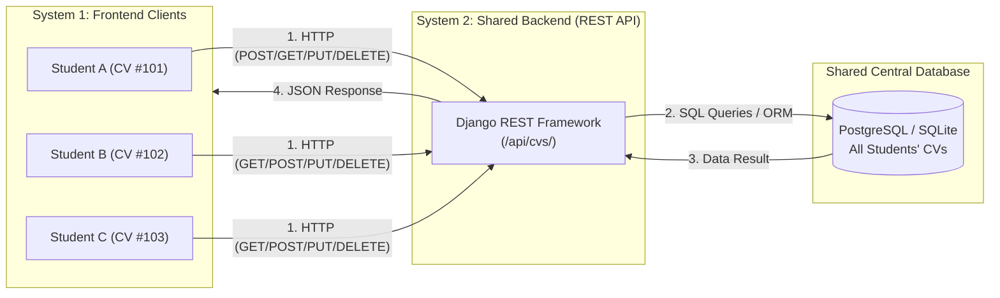

# 🎓 Student CV Hub - REST API Based CRUD System

An end-to-end full-stack web application implementing **REST API-based CRUD operations** connected to a **central shared database** (PostgreSQL / SQLite).

Built using **Django REST Framework (DRF)** for System 2 (Backend), a modern responsive **HTML5/CSS3/JavaScript** interface for System 1 (Frontend), and configured for local testing and cloud hosting on **Render / Neon / Supabase**.

---

## 🏛️ System Architecture



### Core Workflow:
1. **Student opens their profile page:** The frontend sends an API request to the backend.
2. **Backend retrieves information:** Queries the central database.
3. **Backend sends JSON:** Standardized REST response returned.
4. **Frontend renders:** Interactive CV or directory displayed.
5. **Classmate sharing:** Student A, B, and C can view each other's profiles in the Directory.
6. **Strict Ownership:** Student B or C attempting to modify Student A's CV receives an **`HTTP 403 Forbidden`** response unless they possess the owner PIN.

---

## 🔑 Individual Student Authentication & Endpoints

| HTTP Method | Endpoint | Description |
| :--- | :--- | :--- |
| **`POST`** | `/api/auth/login/` | Individual student login with `student_id` (or email) & `password` |
| **`POST`** | `/api/auth/register/` | Register new student account & automatically create their CV |
| **`GET`** | `/api/auth/me/` | Fetch currently logged-in student's profile via Bearer token |
| **`POST`** | `/api/auth/logout/` | Invalidate session token & log out |

---

## ⚡ CRUD API Endpoints

| HTTP Method | Endpoint | Description | Permission |
| :--- | :--- | :--- | :--- |
| **`GET`** | `/api/cvs/` | Retrieve all student CVs (Directory) | Public / All Students |
| **`GET`** | `/api/cvs/{id}/` | Get a specific student's CV (e.g. `/api/cvs/101/`) | Public / All Students |
| **`POST`** | `/api/cvs/` | Create and save a new CV | Anyone (sets owner PIN) |
| **`PUT` / `PATCH`** | `/api/cvs/{id}/` | Update CV information | **Only Owner** (Valid PIN required) |
| **`DELETE`** | `/api/cvs/{id}/` | Delete CV from database | **Only Owner** (Valid PIN required) |

### Example JSON Response (`GET /api/cvs/101/`):
```json
{
  "id": 101,
  "name": "Farzana Sadia Takeei",
  "student_id": "2211175",
  "email": "2211175@iub.edu.bd",
  "education": "BSc in CSE",
  "skills": [
    "Flutter",
    "Python",
    "Cybersecurity"
  ],
  "experience": "Software Development & Mobile Apps",
  "bio": "Undergraduate CSE student at Independent University, Bangladesh...",
  "phone": "+880 1712-345678",
  "avatar_url": "https://images.unsplash.com/photo-1534528741775-53994a69daeb?auto=format&fit=crop&w=400&q=80",
  "created_at": "2026-11-03T16:48:55Z",
  "updated_at": "2026-11-03T16:48:55Z"
}
```

---

## 🐘 PostgreSQL & pgAdmin 4 Local Database Connection

The project is now connected directly to your local **PostgreSQL (v18)** instance:

| Parameter | Value |
| :--- | :--- |
| **Host** | `localhost` or `127.0.0.1` |
| **Port** | `5432` |
| **Database Name** | `student_cv_db` |
| **Username** | `postgres` |
| **Password** | `1234` |
| **Primary CV Table** | `cv_app_studentcv` |

### How to view in pgAdmin 4:
1. Open **pgAdmin 4** (installed at `D:\postgesSQL\pgAdmin 4\runtime\pgAdmin4.exe` or `D:\pgadmin4\`).
2. Under **Servers** $\rightarrow$ **PostgreSQL 18**:
3. Expand **Databases** $\rightarrow$ Click on **`student_cv_db`**.
4. Expand **Schemas** $\rightarrow$ **public** $\rightarrow$ **Tables**.
5. Right-click on **`cv_app_studentcv`** $\rightarrow$ Select **View/Edit Data** $\rightarrow$ **All Rows**.
   You will see all student records with their names, student IDs, emails, skills JSON arrays, and experience!

---

## 🔒 Owner Authorization Model (How classmates' CVs are protected)

When a student creates a CV, they enter a secret **PIN/Passcode** (or default to their Student ID).
- The secret PIN is stored as a secure cryptographic hash in the database and **is never returned** in any GET API responses.
- To **Update** (`PUT`) or **Delete** (`DELETE`), the request must include the PIN via:
  1. HTTP Header: `X-CV-PIN: <pin>`
  2. Or JSON Request Body: `"passcode": "<pin>"`
- If a classmate tries to edit another student's CV without their PIN, the server rejects it with **`403 Forbidden`**.

---

## 🚀 Running Locally

### Step 1: Clone / Open Project
```powershell
cd "c:\Users\DFIT\Downloads\API based CRUD"
```

### Step 2: Install Dependencies
```powershell
pip install -r requirements.txt
```

### Step 3: Run Database Migrations
```powershell
python manage.py makemigrations
python manage.py migrate
```

### Step 4: Seed Sample Students (Student A, B, C)
```powershell
python seed_data.py
```
This populates 8 comprehensive student CV records:
- **CV #101:** Farzana Sadia Takeei (ID: `2211175`) — Flutter, Python, Cybersecurity
- **CV #102:** Md. Jariful Abedin Ovi (ID: `2230907`) — Flutter, Dart, Django REST, Python, PostgreSQL
- **CV #103:** Tanvir Hasan (ID: `2220451`) — Python, PostgreSQL, Docker, FastAPI, Linux
- **CV #104:** Ayesha Siddiqua (ID: `2221304`) — React, Next.js, TypeScript, Tailwind CSS, Redux
- **CV #105:** Naimur Rahman (ID: `2231580`) — AI & Deep Learning, PyTorch, Computer Vision
- **CV #106:** Sabrina Jahan (ID: `2210892`) — UI/UX Design, Figma, User Research, Wireframing
- **CV #107:** Mehedi Hasan Rafi (ID: `2230419`) — Cybersecurity, Penetration Testing, Wireshark, Linux
- **CV #108:** Nusrat Sharmin (ID: `2220764`) — Data Science, SQL, Power BI, Python, Tableau

### Step 5: Start the Development Server
```powershell
python manage.py runserver
```

Now open:
- 🔑 **Individual Student Login Page:** [http://127.0.0.1:8000/login/](http://127.0.0.1:8000/login/)
- 🌐 **Frontend Hub & Directory:** [http://127.0.0.1:8000/](http://127.0.0.1:8000/)
- 📡 **Django REST Browsable API:** [http://127.0.0.1:8000/api/cvs/](http://127.0.0.1:8000/api/cvs/)
- ⚙️ **Django Admin Portal:** [http://127.0.0.1:8000/admin/](http://127.0.0.1:8000/admin/)

---

## 🧪 Testing with Automated Tests & Postman

### Running Automated Test Suite:
```powershell
python manage.py test cv_app
```
*7 unit tests verify all CRUD methods and 403 Forbidden security checks.*

### Running Live E2E Verification Script:
```powershell
python verify_api.py
```

### Testing via Postman:
1. Open **Postman**.
2. Click **Import** and select the file [`postman_collection.json`](./postman_collection.json).
3. The collection includes 6 pre-configured requests:
   - `1. GET All CVs`
   - `2. GET Single Student CV`
   - `3. POST Create New CV`
   - `4. PUT Update CV (Authorized with PIN)`
   - `5. PUT Update CV (Unauthorized - 403 Forbidden)`
   - `6. DELETE CV (Authorized with PIN)`

---

## ☁️ Deploying to Render (Free Cloud Hosting with PostgreSQL)

To enable all classmates to access the central backend and database from their own laptops/phones:

1. Push this project folder to a GitHub repository.
2. Log in to [Render](https://render.com/).
3. Click **New +** $\rightarrow$ **Blueprint** $\rightarrow$ Select your GitHub repository.
4. Render will read [`render.yaml`](./render.yaml), automatically creating:
   - A free **PostgreSQL Database** (`cv-database`).
   - A Python **Web Service** running Gunicorn + WhiteNoise.
   - Automatically populating `DATABASE_URL`.
5. Once deployed, share your public Render URL (e.g. `https://cv-sharing-api.onrender.com/`) with your classmates and teacher!

